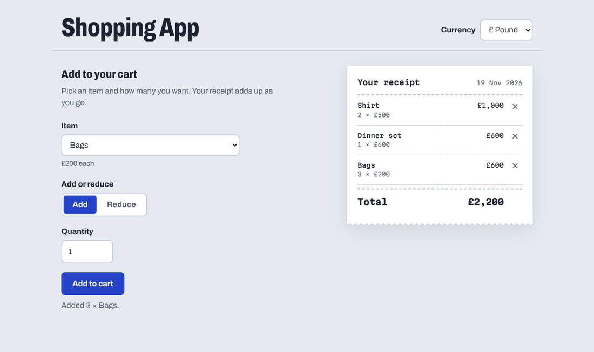
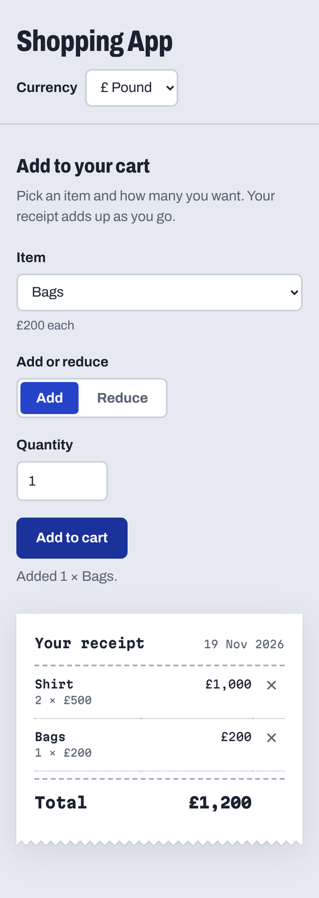

# Shopping App

[](https://github.com/AnnaTverdovska/kduia-shopping-app/actions/workflows/ci.yml)

A small React shopping cart, drawn as a till receipt. Pick an item, add or reduce its quantity,
and the receipt and its total update straight away. Removing an item takes one click, and the
currency symbol can be switched between pound, dollar, euro and rupee.

The project started from IBM Skills Network's shopping cart template, used in IBM's
*Developing Front-End Apps with React* course.

**[Try the live demo](https://annatverdovska.github.io/kduia-shopping-app/)**. It runs entirely
in your browser; nothing is sent anywhere.

| Desktop | Phone |
|---|---|
|  |  |

## Design

The cart is printed as a till receipt: a strip of paper with a torn edge, set in
[Martian Mono](https://github.com/evilmartians/mono), a typeface with the squared-off look of a
receipt printer. New lines appear on the receipt as items are added. Everything around it stays
quiet: a cool grey counter, one cobalt blue for actions, and
[Archivo](https://github.com/Omnibus-Type/Archivo) in a condensed width for the title, like shop
signage.

- Both typefaces are served with the app (no Google Fonts), so the page makes no requests to
  other sites.
- The form says what each button will do ("Add to cart", "Reduce in cart"), shows the unit price
  of the chosen item, and confirms each change in a line that screen readers announce.
- It works on phones, keeps a visible focus outline for keyboard users, and skips the receipt
  animation when the system asks for reduced motion.

## How it works

All state lives in one React context (`src/context/AppContext.js`), managed by `useReducer`.
Components never change the state directly; they dispatch one of four actions:

| Action | What it does |
|---|---|
| `ADD_QUANTITY` | Adds the given number of an item to the cart |
| `RED_QUANTITY` | Takes the given number away, never going below zero |
| `DELETE_ITEM` | Removes an item from the cart |
| `CHG_LOCATION` | Switches the currency symbol |

The reducer always returns a new state object instead of changing the old one, so React
re-renders reliably. The cart total is calculated from the items on every render rather than
stored, so it can never drift out of sync.

| Component | Role |
|---|---|
| `CartValue` | The total at the bottom of the receipt |
| `Location` | Chooses the currency symbol |
| `ExpenseList` | The lines of the receipt, or a note that it is empty |
| `ExpenseItem` | One line: item, quantity × unit price, line total and a remove button |
| `ItemSelected` | The form for adding or reducing items. It rejects a missing item, a quantity that is not a whole number above zero, and reducing an item that is not in the cart |

`src/money.js` formats amounts with the currency symbol and thousands separators (£1,600).

## Running it locally

You need Node.js 18 or newer.

```bash
npm ci        # install the exact versions from package-lock.json
npm start     # development server at http://localhost:3000
npm test      # tests in watch mode
npm run build # production build in build/
```

## Tests

`src/App.test.js` has 10 tests, written with React Testing Library. They cover:

- an empty receipt at the start
- the unit price shown for the chosen item
- adding items, the confirmation and the updated total
- reducing a quantity, which never goes below zero
- the remove button
- switching the currency, which updates every price
- the messages for invalid input
- the reducer leaving the previous state unchanged
- money formatting

GitHub Actions runs the tests and a production build on every push
([`.github/workflows/ci.yml`](.github/workflows/ci.yml)). Every push to `main` also publishes
the live demo with GitHub Pages ([`.github/workflows/pages.yml`](.github/workflows/pages.yml)).

## Changes to the IBM template

This repository is a modified version of IBM Skills Network's template
(`ibm-developer-skills-network/kduia-shopping-app`), licensed under the Apache License 2.0. The
template came with empty components for the learner to complete. AnnaTverdovska wired up
`src/App.js` in 2023 and made all other changes in 2026; the commit history shows each one in
detail. Changed files that allow comments also say so in their first lines.

<details>
<summary>Files changed from the template (19)</summary>

- `.gitignore`
- `README.md`
- `package-lock.json`
- `package.json`
- `public/favicon.ico`
- `public/index.html`
- `public/logo192.png`
- `public/logo512.png`
- `public/manifest.json`
- `src/App.js`
- `src/App.test.js`
- `src/components/CartValue.js`
- `src/components/ExpenseItem.js`
- `src/components/ExpenseList.js`
- `src/components/ItemSelected.js`
- `src/components/Location.js`
- `src/context/AppContext.js`
- `src/index.css`
- `src/index.js`

The three icon files now hold the app's own receipt icon instead of the React logo.

</details>

<details>
<summary>Files added (6, plus the screenshots in docs/)</summary>

- `.github/workflows/ci.yml`
- `.github/workflows/pages.yml`
- `public/favicon.svg`
- `public/licenses/OFL-Archivo.txt`
- `public/licenses/OFL-Martian-Mono.txt`
- `src/money.js`

</details>

<details>
<summary>Files removed (2)</summary>

Unused files left over from Create React App:

- `src/App.css`
- `src/logo.svg`

</details>

## License

[Apache License 2.0](LICENSE), the license of the original template: Copyright 2020 IBM
Developer Skills Network. The template itself was set up with
[Create React App](https://github.com/facebook/create-react-app) (MIT License).

The typefaces are used under the SIL Open Font License 1.1; their license files are published
with the app:

- Archivo, Copyright 2020 The Archivo Project Authors:
  [`public/licenses/OFL-Archivo.txt`](public/licenses/OFL-Archivo.txt)
- Martian Mono, Copyright 2020 The Martian Mono Project Authors:
  [`public/licenses/OFL-Martian-Mono.txt`](public/licenses/OFL-Martian-Mono.txt)

The app icon and the remove icon were drawn for this project.
